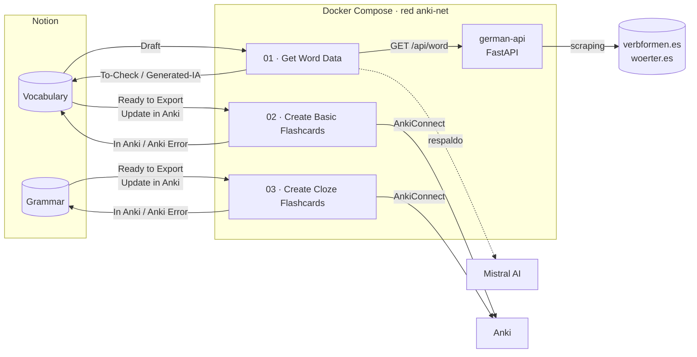
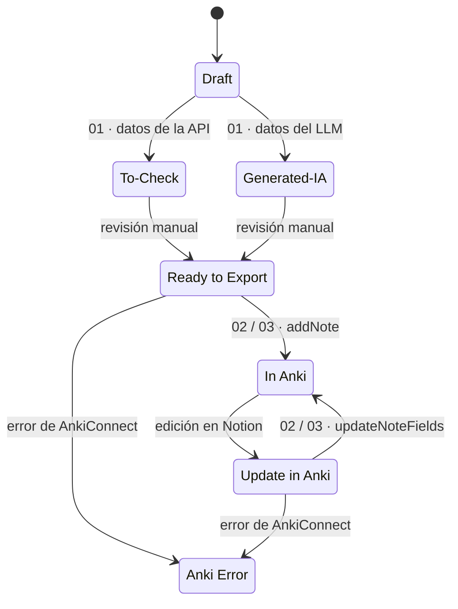

# Anki Pipeline

> Pipeline de automatización que convierte palabras en alemán en tarjetas de **Anki**: una API de scraping en **FastAPI** extrae los datos lingüísticos, **n8n** orquesta el flujo, **Notion** sirve como base de datos con revisión humana y un LLM (**Mistral**) actúa como respaldo cuando el scraping no alcanza.


---

## El problema

Crear tarjetas de vocabulario de alemán a mano es lento y repetitivo. Por cada palabra hay que buscar el artículo (*der / die / das*), la traducción, las formas irregulares (*geht · ging · ist gegangen*) y una frase de ejemplo, y después copiarlo todo a Anki.

Con este proyecto, basta con escribir la palabra en Notion. El pipeline completa los datos, espera tu revisión y crea o actualiza la tarjeta en Anki.

## Arquitectura



| Componente | Rol |
|---|---|
| **`german-api`** | Servicio sin estado que hace scraping de verbformen.es y woerter.es y devuelve un JSON con el mismo formato sin importar la fuente. |
| **n8n** | Orquesta los tres workflows: lee Notion, llama a la API o al LLM, escribe los resultados y sincroniza con Anki. |
| **Notion** | Base de datos del vocabulario y la gramática. El campo `AnkiStatus` controla en qué etapa está cada página. |
| **Mistral AI** | Respaldo para frases y para palabras que la API no puede resolver. |
| **AnkiConnect** | Add-on de Anki que expone una API HTTP para crear y actualizar notas. |

La API **no se publica en el host**: solo se puede llamar desde la red interna de Compose. n8n solo escucha en `127.0.0.1`.

### Ciclo de vida de una página



Nada llega a Anki sin pasar por tu revisión: los datos generados se quedan en `To-Check` o `Generated-IA` hasta que los marcas como `Ready to Export`.

## Workflows de n8n

Los workflows están en [`n8n/`](n8n/), numerados en el orden en que se usan. Cada uno incluye una nota adhesiva con su descripción y la configuración que necesita.

### 01 · Get Word Data

Completa las páginas nuevas de **Vocabulary**.

- **Disparadores:** manual (páginas en `Draft`) o automático, cada 5 min, cuando se crea una página.
- **Enrutamiento:** las frases (`Type = Phrase`) van al LLM. Las palabras se consultan en la API, y si esta devuelve un error, un resultado ambiguo o una respuesta vacía, se usa el LLM como respaldo.
- **Control de carga:** pausa aleatoria de 5 a 10 s entre palabras. Ante un `429`, espera 15 min y detiene la ejecución.
- **Robustez:** descarta los términos vacíos sin detener el lote, y limpia las anotaciones de ejecuciones anteriores para que volver a procesar una página no genere búsquedas inválidas.

### 02 · Create Basic Flashcards

Sincroniza **Vocabulary** con un mazo de tarjetas Basic.

- `Ready to Export` → `addNote` y guarda el ID de la nota en Notion (`AnkiID`).
- `Update in Anki` → `updateNoteFields` y actualiza solo las etiquetas que administra el pipeline. Las etiquetas propias, como `leech` o `marked`, se conservan.
- Etiqueta: `German::Vocabulary::<Type>`.

### 03 · Create Cloze Flashcards

Hace lo mismo con **Grammar**, en tarjetas Cloze (`{{c1::...}}`). Etiqueta: `German::Grammar::<Topic>`.

En los dos casos, el mazo, el tipo de nota, los campos y las etiquetas se definen en un único nodo, **Prepare Note**.

## API: referencia

La documentación interactiva se genera automáticamente en `/docs` (Swagger UI) y `/redoc`.

### `GET /api/word`

| Parámetro | Tipo | Requerido | Descripción |
|---|---|---|---|
| `w` | `string` | Sí | Palabra en alemán. Admite letras (incluidas diéresis y ß), espacios, guiones, apóstrofos y puntos. |
| `c` | `string` | No | Categoría: `verb`, `noun`, `adjective`, `adverb`, `article`, `pronoun`, `preposition`, `conjunction`, `particle`. Si se omite, se hace una búsqueda general. |

#### Ejemplo: sustantivo

`GET /api/word?w=Haus&c=noun`

```json
{
  "status": "success",
  "status_code": 200,
  "meta": {
    "requested_word": "Haus",
    "requested_type": "noun",
    "source_url": "https://www.verbformen.es/declinacion/sustantivos/Haus.htm"
  },
  "data": {
    "word": "Das Haus",
    "type": "Noun",
    "gender": "n.",
    "translate": "Casa - Hogar - Cámara",
    "context": "neutral | irregular | -s, -er",
    "example": "Ich geh nach Hause. - Me voy a casa."
  }
}
```

El campo `context` cambia según la categoría:

| Categoría | `context` |
|---|---|
| Sustantivo | Género, declinación y terminaciones: `neutral \| irregular \| -s, -er` |
| Verbo | Formas principales: `geht \| ging \| ist gegangen` |
| Adjetivo | Grados: `schnell \| schneller \| am schnellsten` (o `No comparable`) |

#### Ejemplo: búsqueda ambigua

Si no se indica la categoría y la palabra tiene varios significados, la API no elige uno al azar: devuelve `status: "ambiguous"` con los candidatos.

`GET /api/word?w=sein`

```json
{
  "status": "ambiguous",
  "status_code": 200,
  "meta": {
    "requested_word": "sein",
    "requested_type": null,
    "source_url": "https://www.verbformen.es/?w=sein"
  },
  "data": [
    { "type": "verbo",    "word": "sein", "path": "https://www.verbformen.es/conjugacion/sein.htm" },
    { "type": "artículo", "word": "sein", "path": "https://www.verbformen.es/declinacion/articulos/sein.htm" }
  ]
}
```

> Los datos de estos ejemplos provienen de [verbformen.es](https://www.verbformen.es) y están sujetos a la licencia de su fuente (ver [Fuentes y licencias](#fuentes-y-licencias)).

#### Códigos de error

| Código | Cuándo |
|---|---|
| `400` | `w` está vacío o contiene caracteres no válidos (p. ej. `Hund)` o `a/b`). |
| `404` | La palabra no existe o la categoría no es válida. |
| `429` | La fuente está limitando las peticiones. |
| `502` | No se pudo conectar con la fuente. |
| `500` | Error inesperado al interpretar la página. |

### `GET /`

Health check: `{ "message": "API lista" }`.

## Puesta en marcha

### Requisitos

- Docker y Docker Compose
- Anki de escritorio con el add-on [AnkiConnect](https://ankiweb.net/shared/info/2055492159)
- Una integración de Notion con acceso a las bases de datos
- Una API key de [Mistral AI](https://console.mistral.ai/)
- Python **3.12+**, solo si quieres ejecutar la API sin Docker

### 1. Levantar los servicios

```bash
git clone https://github.com/yoltzinbur/anki-pipeline.git
cd anki-pipeline

cp .env.example .env    # ajusta zona horaria, puerto, etc.
docker compose up -d --build
```

n8n queda disponible en **http://localhost:5678**.

### 2. Preparar Notion

Crea dos bases de datos con estas propiedades. Los nombres deben coincidir exactamente.

**Vocabulary**

| Propiedad | Tipo | Uso |
|---|---|---|
| `Term` | Title | Palabra o frase, p. ej. `das Haus`. |
| `NameFilter` | Formula | El término sin artículo (`Haus`); es lo que se envía a la API. |
| `Type` | Select | `Noun`, `Verb`, `Adjective`, …, o `Phrase` para enviarlo directo al LLM. |
| `Gender` | Select | `m.`, `f.`, `n.` |
| `Translate`, `Context`, `Example` | Text | Datos generados. |
| `AnkiStatus` | Select | Estado de la página (ver el ciclo de vida). |
| `AnkiID` | Number | ID de la nota en Anki; lo escribe el pipeline. |

**Grammar**

| Propiedad | Tipo | Uso |
|---|---|---|
| `ClozeText` | Title | Oración con huecos: `Ich {{c1::rufe}} dich morgen {{c2::an}}.` |
| `Topic` | Select | Tema gramatical, p. ej. `Trennbare Verben`. |
| `Extra` | Text | Explicación o traducción. |
| `AnkiStatus`, `AnkiID` | — | Igual que en Vocabulary. |

### 3. Preparar Anki

Abre Anki con AnkiConnect activo y crea estos tipos de nota:

- **Basic** con los campos `Front`, `Back`, `Context` y `Example`.
- **Cloze** con los campos `Text`, `Back Extra` y `Topic`.

Los mazos `German::Vocabulary` y `German::Grammar` se crean solos al agregar la primera nota.

> **Linux:** `host.docker.internal` no existe por defecto. Agrega `extra_hosts: ["host.docker.internal:host-gateway"]` al servicio `n8n` y configura `webBindAddress: "0.0.0.0"` en AnkiConnect. En Docker Desktop (Windows y macOS) funciona sin cambios.

### 4. Importar los workflows

1. En n8n, ve a **Workflows → Import from File** e importa los tres archivos de `n8n/`.
2. Crea las credenciales **Notion API** y **Mistral Cloud API** y asígnalas a los nodos que las piden.
3. Reemplaza los valores de ejemplo en los nodos de Notion:
   - `<YOUR_NOTION_VOCABULARY_DATABASE_ID>`
   - `<YOUR_NOTION_GRAMMAR_DATABASE_ID>`
4. Prueba cada workflow con su **Manual Trigger** y, cuando funcione, actívalo.

### Ejecutar la API en local (desarrollo)

```bash
python -m venv .venv
source .venv/bin/activate        # Windows: .venv\Scripts\activate
pip install -r requirements.txt

uvicorn main:app --reload --port 5000
```

```bash
curl "http://localhost:5000/api/word?w=gehen&c=verb"
```

### Variables de entorno

| Variable | Por defecto | Uso |
|---|---|---|
| `N8N_HOST` | `localhost` | Host público de n8n. |
| `N8N_PORT` | `5678` | Puerto de n8n (enlazado solo a `127.0.0.1`). |
| `N8N_PROTOCOL` | `http` | Protocolo de n8n. |
| `WEBHOOK_URL` | `http://localhost:5678/` | URL base de los webhooks de n8n. |
| `GENERIC_TIMEZONE` | `UTC` | Zona horaria de los nodos programados. |
| `N8N_ENCRYPTION_KEY` | — | Clave para cifrar las credenciales guardadas en n8n. Se recomienda definirla. |

## Estructura del proyecto

```
anki-pipeline/
├── main.py                              # API FastAPI: validación, scraping y parsers
├── requirements.txt                     # Dependencias fijadas
├── Dockerfile                           # Imagen multi-stage, usuario sin privilegios
├── docker-compose.yml                   # Servicios n8n + german-api en red privada
├── .env.example                         # Plantilla de configuración
└── n8n/
    ├── 01-get-data-word.json            # Notion → API / LLM → Notion
    ├── 02-create-basic-flashcard.json   # Vocabulary → Anki (Basic)
    └── 03-create-cloze-flashcard.json   # Grammar → Anki (Cloze)
```

## Decisiones de diseño

- **Revisión humana antes de Anki.** Ni el scraping ni el LLM escriben directamente en Anki. Todo pasa por un estado de revisión en Notion, porque una tarjeta con un error es peor que no tener tarjeta.
- **Scraping primero, LLM como respaldo.** Las fuentes especializadas dan datos gramaticales más fiables (artículo, plural, formas irregulares) que un LLM. La IA solo se usa con frases o cuando la API no resuelve la palabra.
- **Un formato de respuesta para todas las fuentes.** Cada sitio tiene un HTML distinto, pero los dos parsers devuelven las mismas claves. Así, n8n no necesita saber de qué sitio vino el dato.
- **`ambiguous` como estado explícito.** Ante varios candidatos, la API devuelve las opciones en vez de adivinar.
- **Validación en el borde.** La API rechaza entradas mal formadas con un `400` en lugar de pasarlas a las fuentes. Así, un dato incorrecto en Notion no tumba el servicio.
- **Procesos idempotentes.** Volver a procesar una página no acumula anotaciones, y al actualizar una nota solo se tocan las etiquetas que administra el pipeline.
- **Errores visibles, no silenciosos.** Si AnkiConnect rechaza una nota, la página queda en `Anki Error` y el lote continúa.
- **Red privada por defecto.** La API no tiene autenticación, así que no se expone al host.

## Limitaciones conocidas

- **Depende del HTML de terceros.** Si verbformen.es o woerter.es cambian su estructura, habrá que actualizar los parsers.
- **Verificación TLS desactivada en woerter.es** (`verify=False`), como solución temporal a un problema con su certificado.
- **Anki debe estar abierto** para que los workflows 02 y 03 puedan sincronizar.
- Las peticiones a la API se hacen en serie y sin caché.

## Roadmap

- [ ] Tests con fixtures de HTML guardado para detectar cambios en los sitios.
- [ ] Caché de respuestas (p. ej. Redis o SQLite).
- [ ] Modelos Pydantic para validar y documentar el esquema de respuesta.
- [ ] Separar `main.py` en módulos (`routes`, `scrapers`, `parsers`).

## Fuentes y licencias

Este proyecto es independiente y **no está afiliado a Netzverb** ni a ninguna de las fuentes. Este repositorio publica código, no los datos: la API los consulta en el momento en que se le piden.

| Contenido | Fuente | Licencia |
|---|---|---|
| Datos lingüísticos (traducciones, formas, declinaciones) | Netzverb ([www.verbformen.de](https://www.verbformen.de)), vía [verbformen.es](https://www.verbformen.es) y [woerter.es](https://www.woerter.es) | [CC BY-SA 4.0](https://creativecommons.org/licenses/by-sa/4.0/) |
| Frases de ejemplo | [Tatoeba](https://tatoeba.org) | [CC BY 2.0 FR](https://creativecommons.org/licenses/by/2.0/fr/) |
| Definiciones y frases | [Wiktionary](https://de.wiktionary.org) | [CC BY-SA 3.0](https://creativecommons.org/licenses/by-sa/3.0/) |

Si usas este código:

- **Respeta a las fuentes:** mantén pausas entre peticiones y no hagas consultas masivas.
- **Si republicas los datos** (por ejemplo, al compartir un mazo de Anki), cita a Netzverb (www.verbformen.de) con un enlace, indica la licencia CC BY-SA 4.0 y publica el resultado bajo la misma licencia.

## Licencia

[MIT](LICENSE) © 2026 Yoltzin Iván Ruiz Burciaga
